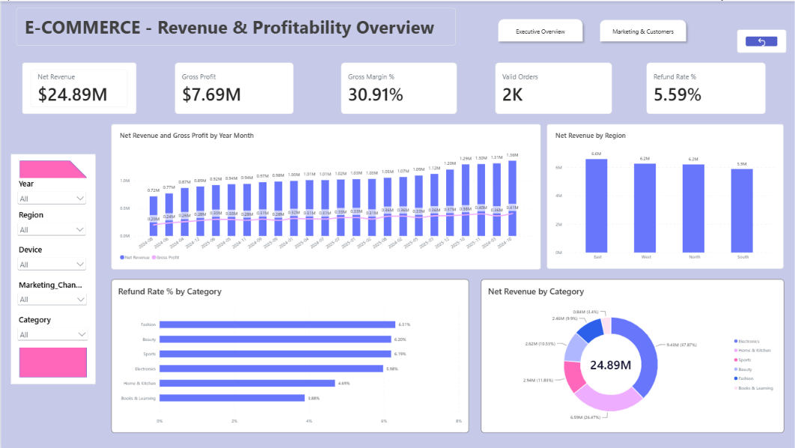
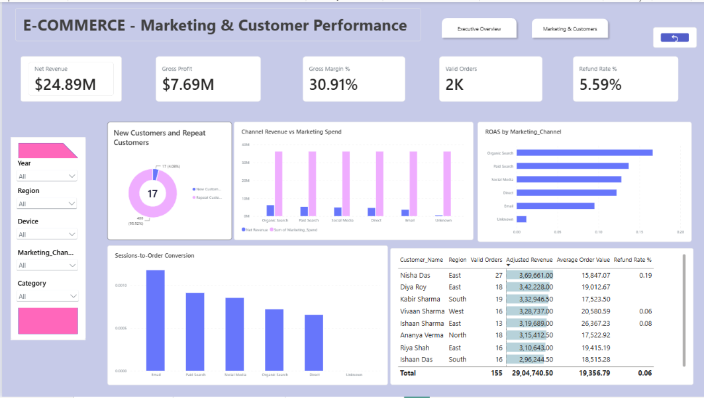
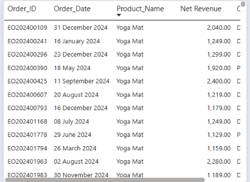

# Ecommerce Data Analysis Dashboard

Professional Power BI solution for an online retail company.  
This repository contains the complete Power BI template (`.pbit`), documentation, DAX logic, KPI definitions, data model details, and business insights derived from the analysis.

## Business Scenario

You are a junior analyst for an online retail company. Leadership wants clear visibility into:

- Revenue & profitability
- Refund behaviour
- Marketing efficiency (ROAS, conversion)
- Channel performance
- Repeat-customer behaviour

## Report Pages

| Page | Purpose |
|------|---------|
| **Executive Commerce** | High-level KPIs, monthly trend, revenue by region & category, refund rate by category |
| **Marketing & Customers** | Channel Revenue vs Spend, ROAS, conversion rate, New vs Repeat customers, Top customers + tooltip |
| **Tooltip - Customer Orders** | Order history tooltip used on the Top Customers visual |

## How to Open the Report

1. Open **Power BI Desktop**.
2. File → Open → select `report/Ecommerce Data Analysis Dashboard.pbit`.
3. When prompted, connect to the source Excel file (or the data source used during development).
4. Refresh the data.

> **Note**: A `.pbit` file is a template. It contains the model, measures, and visuals but **not** the data. You must point it to the source Excel workbook.

## Key Measures Included

- Valid Orders  
- Product Revenue / Shipping Revenue / Net Revenue  
- COGS / Gross Profit / Gross Margin %  
- Average Order Value  
- Refunded Orders / Refund Rate % / Refund Value  
- Adjusted Revenue  
- Repeat Customer Rate %  
- Marketing Spend / ROAS  
- Order Conversion Rate %  
- Revenue YTD / Revenue YoY %  
- New Customers / Repeat Customers  

## Tools Used

- Microsoft Power BI Desktop
- DAX
- Power Query (data cleaning)
- Star-schema modelling

## Author Notes

All cleaning rules, assumptions, and business logic are documented inside the markdown files in the `documentation/` folder.
